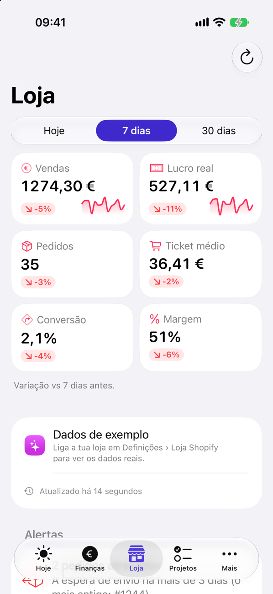
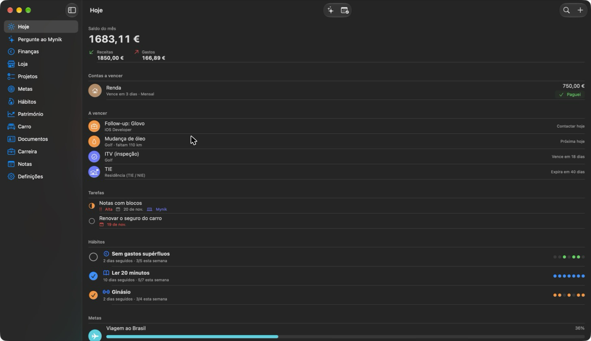
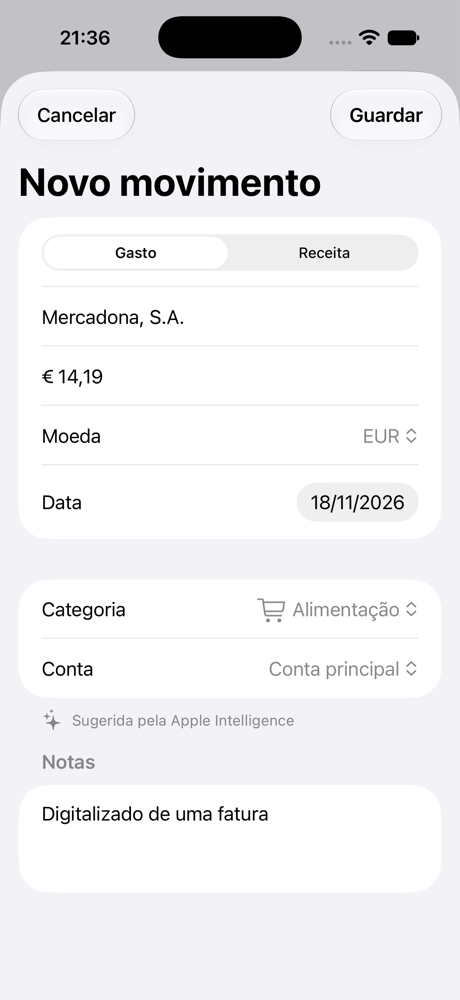
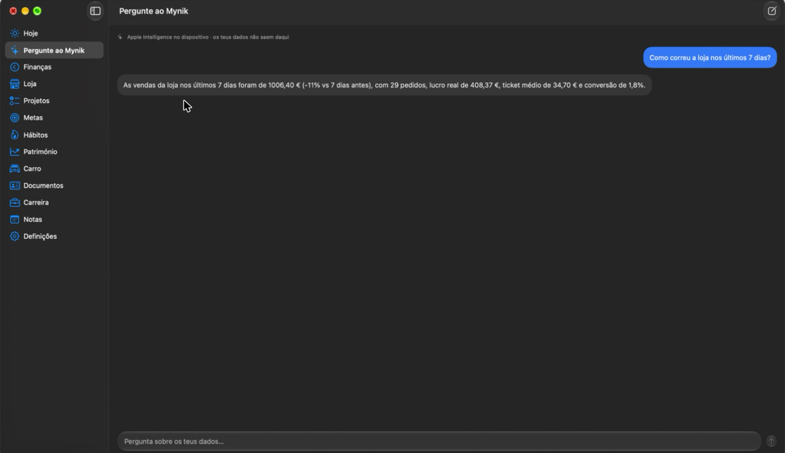
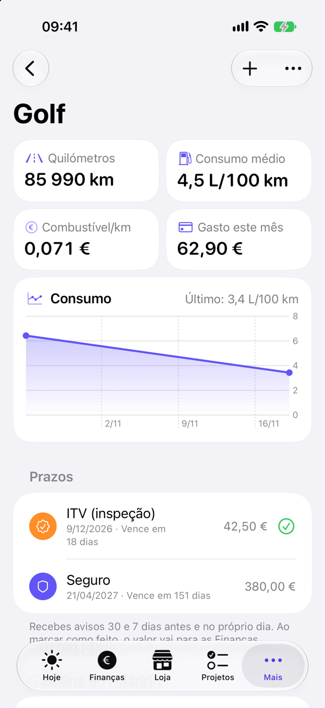
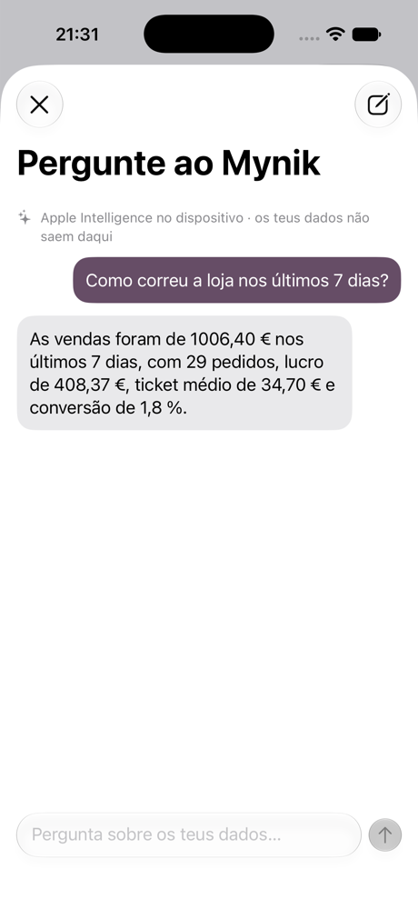
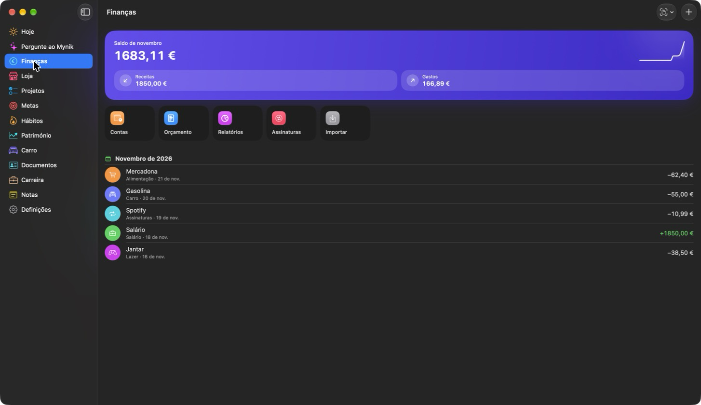
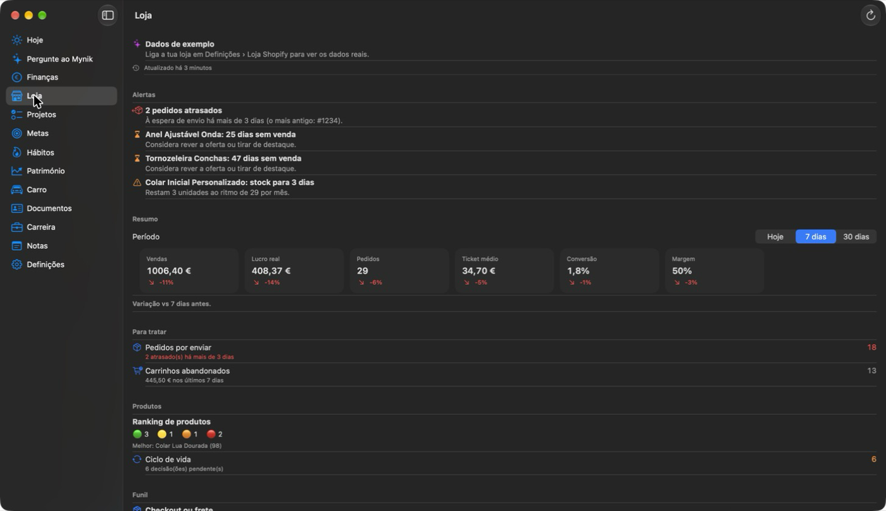

<p align="center"></p>

# Mynik

> *A tua vida, num só lugar.*

**Dashboard pessoal nativa para iPhone e Mac**: finanças, contas a pagar, analytics da loja Shopify, projetos, notas, hábitos, carro, documentos, carreira e património numa só app SwiftUI, com IA no dispositivo e sem servidores.

    

<p align="center">
  
  
  
  
</p>

<p align="center">
  
</p>

## Destaques
- 📱💻 **Um só código** para iPhone e Mac (SwiftUI multiplataforma): barra lateral no Mac/iPad, separadores no iPhone, ⌘K para pesquisar tudo.
- 🤖 **IA no dispositivo** (Foundation Models): categoriza os gastos sozinha e responde a perguntas sobre os teus dados ("Pergunte ao Mynik") com *tool calling* que lê o SwiftData. Sem Apple Intelligence, tudo continua a funcionar com regras e resumos.
- 🧾 **Scanner de faturas**: câmara de documentos do VisionKit e OCR do Vision extraem comerciante, total e data, e o gasto aparece já categorizado.
- 💶 **Finanças completas**: orçamento, contas a pagar com alertas e **Live Activity / Dynamic Island**, assinaturas, multi-moeda EUR/BRL, importação de CSV e gastos automáticos via **Apple Pay**.
- 🛍️ **Shopify Analytics**: lucro real (sem IVA, custos, envios, taxas e anúncios), ranking de produtos 0–100 com ação sugerida e diagnóstico do funil.
- 🔥 **Hábitos, revisão semanal ao domingo**, projetos em Kanban, notas estilo Notion com Markdown, carro, documentos com Face ID, carreira e património.
- 🔄 **Sync Mac ⇄ iPhone pelo Supabase**, *local-first*: login opcional por email, last-write-wins e tombstones, a app funciona sem conta e sem rede.
- 🧩 Widgets, Siri/Atalhos, barra de menus no Mac, Calendário e Lembretes na tela Hoje.
- 🎨 **Sistema visual próprio** (`Core/DesignSystem`): cor da marca, uma cor por módulo, números arredondados, cartões de KPI com mini gráficos e um ícone gerado com CoreGraphics ([scripts/make-icon.swift](scripts/make-icon.swift)).
- ♿️ Liquid Glass nos controlos, modo escuro, Dynamic Type, VoiceOver, contraste AA e Reduzir movimento.

<details>
<summary><b>Mais screenshots</b></summary>

| | | |
|:-:|:-:|:-:|
|  |  |  |
| Fatura digitalizada → gasto | Conta de hoje na Dynamic Island | Modo escuro |
|  |  |  |
| Finanças | Modo sem IA (resumos) | Chat no Mac |
|  |  |  |
| Carro | Pergunte ao Mynik | Hábitos |




</details>

## Arquitetura
```
Mynik/
  App/            MynikApp, RootView, navegação (AppRouter partilhado, barra lateral / separadores)
  Core/
    Models/       modelos SwiftData (compatíveis com CloudKit: defaults, relações opcionais, sem @Attribute(.unique))
    Persistence/  esquema versionado V1→V6 com migrações lightweight testadas, dados de exemplo
    Services/     sync (Supabase), IA (Foundation Models), backup JSON, Shopify, notificações, Live Activity, Keychain, câmbio...
    Utils/        lógica pura e testável: métricas da loja, scorer de produtos, regras de categorias, parser de faturas
    Shared/       código partilhado com a extensão de widgets (resumo por App Group, Live Activity)
  Features/       um módulo por secção (Today, Finance, Store, Assistant, Habits, Search, ...) com views pequenas
  Widgets/        WidgetKit + Live Activity / Dynamic Island
  Intents/        App Intents (Siri, Atalhos, Apple Pay)
MynikTests/       Swift Testing, com a app como anfitrião e base de dados em memória
```
- **Swift 6 com isolamento `MainActor` por omissão** e concorrência estrita; o que corre fora (ferramentas do modelo, OCR) é `nonisolated`/`@concurrent` e só leva tipos `Sendable`.
- **Lógica fora das views**: serviços e utilitários puros (`ProductScorer`, `MerchantCategoryRules`, `ReceiptParser`, `WeeklyReview`...) com testes; as views só desenham.
- **Esquema versionado**: cada versão publicada é congelada (`MynikSchemaV1`…`V5`) e há um teste de migração a partir de uma base antiga gravada em disco.
- **Modo de demonstração** (`-MynikDemo`): dados de exemplo em memória, sem tocar nos dados reais nem nos widgets — é o que gera as screenshots.

## Decisões técnicas
- **Sync local-first com Supabase em vez de CloudKit.** O sync por iCloud exige o Apple Developer Program. O SwiftData continua a ser a fonte; o Supabase guarda uma cópia numa **tabela genérica** `records(user_id, entity, key, payload jsonb, deleted, modified_at, updated_at)` ([SQL](supabase/migrations/20261121000000_records.sql)), em que o `payload` é o mesmo registo JSON da cópia de segurança — mudar os modelos não obriga a mudar a base de dados. Como os modelos não têm data de alteração, o `SyncEngine` descobre o que mudou por hash desde o último sync; os conflitos resolvem-se por **last-write-wins** (também no servidor, com um gatilho) e apagar envia um **tombstone**. RLS com `auth.uid()` em tudo; a app só tem a chave pública. A cópia JSON (AirDrop, iCloud Drive ou Ficheiros) continua disponível.
- **Sem plano pago da Apple.** Nada de notarização, TestFlight nem push remoto: a app do Mac é distribuída por uma cask do Homebrew e assinada com o certificado grátis da Personal Team (o que permite o App Group dos widgets). As Live Activities são atualizadas localmente pela app e as notificações são todas locais.
- **IA só no dispositivo.** Foundation Models com verificação de disponibilidade em runtime; a categorização limita a resposta às categorias existentes (`DynamicGenerationSchema`) e o chat junta os dados do tema à pergunta, porque o modelo pequeno nem sempre chama as ferramentas. Sem Apple Intelligence há sempre um caminho com regras.
- **APIs grátis e sem chaves**: câmbio do BCE ([Frankfurter](https://frankfurter.dev)), preços de combustível do Ministerio para la Transición Ecológica, cotações do Yahoo Finance. A Shopify usa só *scopes* de leitura e o token fica no **Keychain**, nunca no código.
- **Privacidade**: Face ID opcional para abrir a app, números e fotos dos documentos atrás de autenticação própria (e fora da busca global). Sem conta, nenhum dado sai do dispositivo; com conta, só para o teu projeto Supabase (protegido por RLS), e nunca as fotos dos documentos nem os segredos.

## Estado — v1.3
✅ **Fase 1 (MVP) concluída**: projeto multiplataforma, modelos SwiftData, navegação adaptativa (barra lateral no Mac/iPad, separadores no iPhone), Finanças (lista, adicionar e editar gastos/receitas) e tela Hoje (saldo do mês, últimos gastos, contas a vencer).

✅ **Fase 2 (Finanças completas) concluída**: contas a pagar com recorrência e botão "paguei", notificações de vencimento, orçamento mensal por categoria, relatórios com Swift Charts, assinaturas (total mensal/anual), importação de extratos CSV (com deteção de duplicados; exemplo em [docs/exemplo-extrato.csv](docs/exemplo-extrato.csv)) e multi-moeda EUR/BRL com taxa do BCE.

✅ **Fase 3 (Loja Shopify — Neloce) concluída**: ligação à Admin GraphQL API (credenciais do app no Keychain, respeito pelo limite por custo), cache em SwiftData, KPIs com comparação e **lucro real** (sem IVA, custo dos artigos, envios, taxas e anúncios), gráfico diário, **ranking de produtos** com score 0–100 e ação sugerida, diagnóstico do funil, carrinhos abandonados, pedidos por enviar, alertas e notificações de venda locais, ciclo de vida do produto e lucro mensal lançado nas Finanças. Sem loja ligada, o módulo mostra uma loja de exemplo.

✅ **Fase 4 (Projetos, metas e notas) concluída**: projetos com tarefas em **Kanban** (arrastar entre colunas) ou lista, prioridade e prazo, tarefas avulsas; **metas** com valor-alvo e prazo ligadas às Finanças (saldo de uma conta ou movimentos de uma categoria, com quanto juntar por mês); **notas** estilo Notion com páginas aninhadas e blocos (texto, título, checklist, imagem), **Markdown** (atalhos ao escrever, exportar e colar) e ligações entre notas, projetos e movimentos, incluindo menções `[[Título]]`. Tarefas do dia e metas aparecem na tela Hoje.

✅ **Fase 5 (Vida) concluída**: **carro** com abastecimentos e consumo (L/100 km), manutenções, prazos de ITV, seguro e imposto com avisos (gastos na categoria Carro) e **preços de combustível em Espanha** perto de ti (API do Ministerio, com cache offline); **documentos** com validade e avisos antes de expirar, números e fotos protegidos por **Face ID / Touch ID**; **carreira** com candidaturas por estado, taxa de resposta, follow-ups e cursos/certificações; **património** com total investido, cotações do dia (Yahoo Finance + câmbio do BCE), aportes, evolução diária e meta de poupança. Os prazos aparecem em "A vencer" na tela Hoje.

✅ **Fase 6 (Ecossistema Apple) concluída**, adaptada a quem não paga o Apple Developer Program: em vez do sync por iCloud (CloudKit), **cópia de segurança JSON** completa com fusão sem duplicados, para levar os dados entre dispositivos por AirDrop, iCloud Drive ou Ficheiros; **widgets** de saldo do mês e contas a vencer (iPhone, ecrã bloqueado e Mac); **Siri e Atalhos** ("Gastei em Alimentação no Mynik", saldo do mês); **automação Apple Pay → gasto** (ver o guia abaixo); **barra de menus** no Mac com saldo, contas e gasto rápido; **Calendário e Lembretes** de hoje na tela Hoje.

✅ **Fase 7 (IA e extras) concluída**: **categorização automática** dos movimentos com a Apple Intelligence (Foundation Models no dispositivo, só entre as categorias existentes) e, sem ela, pelo histórico e por comerciantes conhecidos; **"Pergunte ao Mynik"**, um chat sobre finanças, contas, loja, carro, documentos, carreira, metas e património com *tool calling* que lê o SwiftData (e modo sem IA com resumos por tema); **scanner de faturas** (câmara de documentos do VisionKit ou foto/ficheiro, OCR do Vision que extrai comerciante, total e data); **Live Activity e Dynamic Island** da conta que vence hoje (atualizações locais); **revisão semanal** ao domingo, **hábitos** com sequência e objetivo semanal e **busca global ⌘K**.

✅ **Fase 8 (Polimento e lançamento) concluída — v1.0**: Liquid Glass (botões de vidro, barra de separadores que encolhe), cor de destaque com variantes para modo escuro e alto contraste, Dynamic Type com layouts verticais nos tamanhos de acessibilidade, Reduzir movimento, rótulos únicos para VoiceOver e Controlo por Voz; **Face ID opcional** para abrir a app; cópia de segurança completa com os hábitos; **223 testes** com Swift Testing; screenshots reais e este README. O TestFlight ficou de fora por exigir o plano pago (ver [Instalar](#instalar)).

✅ **v1.1 — Redesign visual**: design system em `Core/DesignSystem` (tokens de espaçamento e raio, cor da marca violeta com variantes, cor de destaque por módulo, tipografia dos números com `.rounded` e algarismos fixos, cartões, KPIs com variação e mini gráficos em Swift Charts, estados vazios); tela **Hoje** em painel de cartões com o saldo sobre o gradiente da marca, ações rápidas em Liquid Glass e duas colunas no Mac; **Finanças** e **Loja** com KPIs e gráficos mais limpos, seletor de período em vidro com `matchedGeometryEffect`; Carro, Carreira, Património, Projetos, Documentos e Definições com o mesmo sistema; haptics no iPhone; **ícone da app** gerado por código. Contraste verificado (≥ 4,5:1) e layouts próprios para os tamanhos de acessibilidade.

✅ **v1.2 — Google Ads**: o gasto diário do Google Ads entra no lucro real da loja, importado de uma folha do Google Sheets (sem API paga nem developer token).

✅ **Fase 9 (Login e sync) concluída — v1.3**: **sync entre o Mac e o iPhone pelo Supabase**, no lugar do CloudKit. *Local-first*: o SwiftData continua a ser a fonte e a app funciona sem conta e sem rede; com sessão iniciada (Definições → Conta, por email com link ou código, sessão no Keychain), cada registo vai para uma tabela `records` com RLS, com **last-write-wins** por registo e **tombstones** para o que se apaga. Sincroniza ao abrir, ao voltar ao primeiro plano e 3 s depois de gravar. As fotos dos documentos e os segredos nunca saem do dispositivo. **243 testes** (Swift Testing), incluindo merge, conflitos e tombstones com dois dispositivos simulados.

Detalhe de cada fase em [ROADMAP](docs/ROADMAP.md) e [CHANGELOG](CHANGELOG.md).

## Instalar
**Mac**
```bash
brew install --cask domyniik/tap/mynik
```
Requer macOS 26 (Tahoe). Para atualizar: `brew update && brew upgrade --cask mynik`. A app é assinada com o certificado gratuito *Apple Development* (Personal Team) e não é notarizada; a cask retira a quarentena. Na primeira abertura depois de atualizar, o macOS pode pedir uma vez acesso aos dados ou ao Keychain (token da Shopify): escolhe **Permitir sempre**.

**iPhone** — sem TestFlight (exige o plano pago): compila e instala a partir do Xcode com o teu Apple ID, ou instala o `.ipa` com o [Sideloadly](https://sideloadly.io). Com um Apple ID grátis a assinatura dura 7 dias e tem de ser renovada. Os widgets leem o App Group `group.com.domynik.mynik`; se o Sideloadly mudar o identificador do grupo, ficam em "Abre o Mynik".

Para publicar uma versão: `scripts/release.sh <versão>` (compila, cria a release no GitHub e atualiza a [tap](https://github.com/Domyniik/homebrew-tap)).

## Como correr
Requer Xcode 27+. O projeto é gerado com [XcodeGen](https://github.com/yonaskolb/XcodeGen) a partir de `project.yml`:

```bash
brew install xcodegen
xcodegen generate
open Mynik.xcodeproj
```

Login e sync (opcional): copia `Config/Supabase.xcconfig.example` para `Config/Supabase.xcconfig` (fora do git) e preenche o *Reference ID* e a chave pública (*publishable/anon*) do teu projeto Supabase; aplica [supabase/migrations](supabase/migrations) no SQL Editor e acrescenta `mynik://login` às *Redirect URLs* (Authentication → URL Configuration). Sem esse ficheiro a app compila e funciona sem login.

Testes (Swift Testing):
```bash
xcodebuild -project Mynik.xcodeproj -scheme Mynik -destination 'platform=macOS' test
```

Modo de demonstração com dados de exemplo: no esquema do Xcode, acrescenta o argumento `-MynikDemo` (ou `xcrun simctl launch booted com.domynik.mynik -MynikDemo`).

## Apple Pay → Mynik (automação dos Atalhos)
Cada pagamento com o Apple Pay pode entrar sozinho nas Finanças:

1. Abre **Atalhos → Automação → Nova automação → Transação**.
2. Escolhe os cartões, deixa todas as categorias e marca **Executar imediatamente**.
3. Em **Nova automação em branco**, adiciona a ação **Registar compra do Apple Pay** (Mynik).
4. Toca em **Comerciante** e escolhe a variável *Comerciante*; em **Valor**, a variável *Montante* (opcional: **Cartão** → *Cartão ou passe*).

A categoria é a do último gasto no mesmo comerciante (ou adivinhada pelo nome; senão "Outros") e um pagamento repetido no mesmo minuto não é registado duas vezes. Também há "Registar gasto" (*"Gastei em Alimentação no Mynik"*) e "Saldo do mês" na Siri e nos Atalhos.

---
Desenvolvido por **Domynik**, com Claude Code como par de programação.
