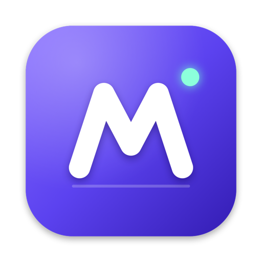
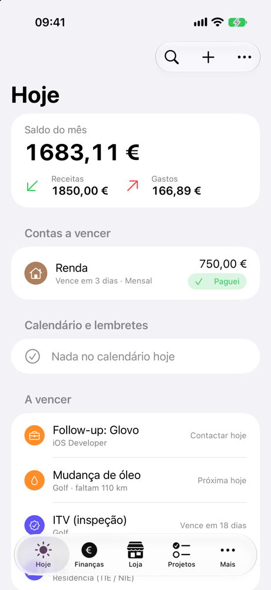
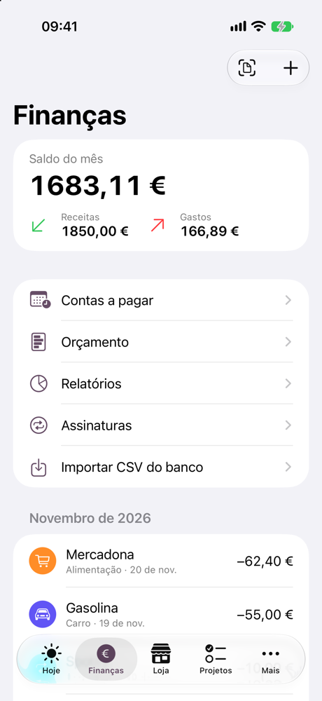
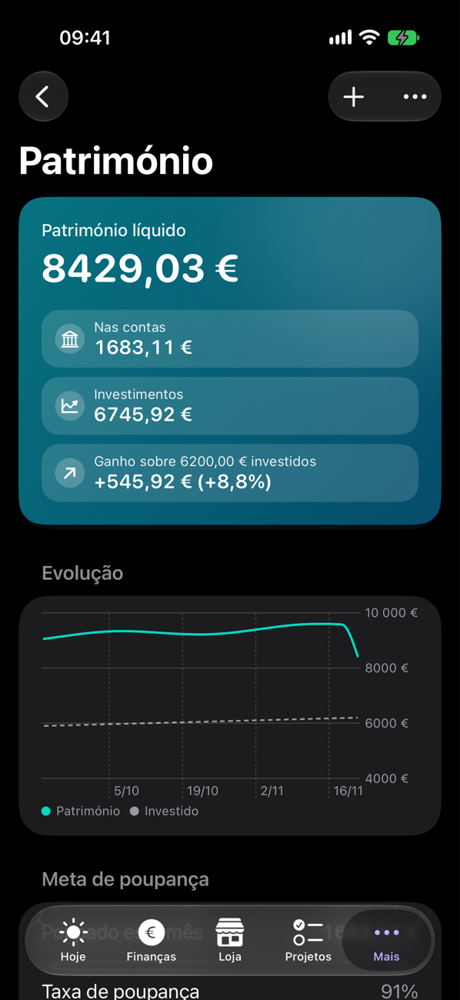
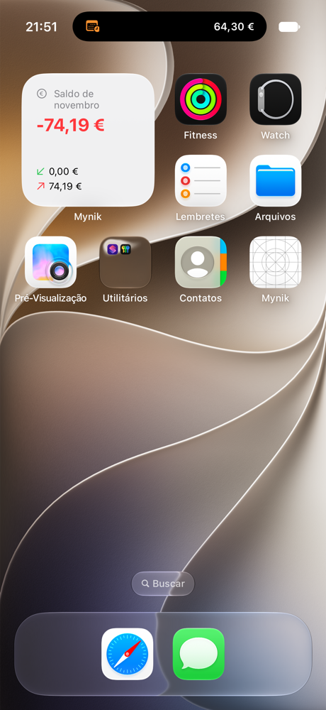
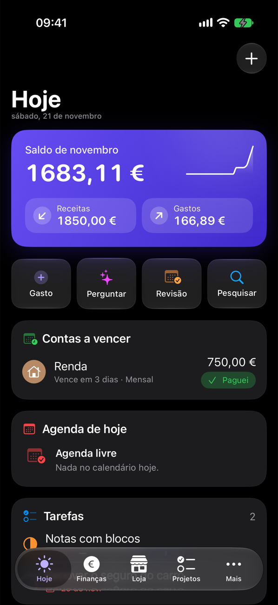
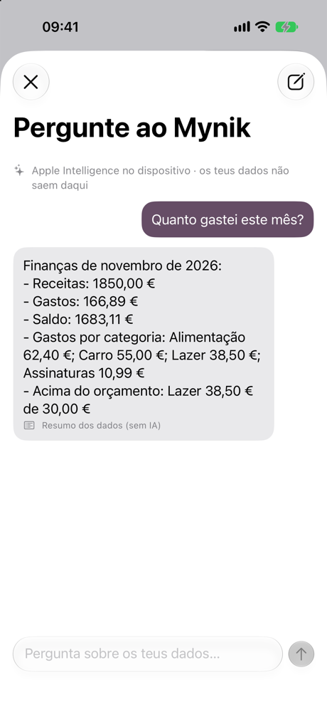
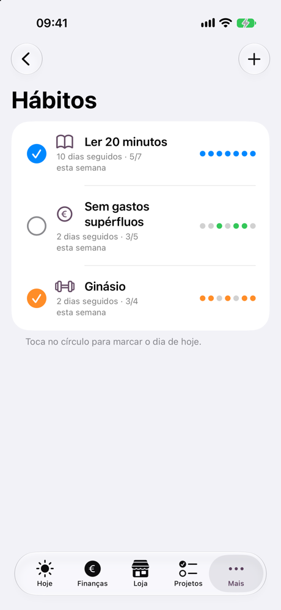

<p align="center"></p>

# Mynik

> *A tua vida, num só lugar.*

**Dashboard pessoal para iPhone, Mac e Windows**: finanças, contas a pagar, analytics da loja Shopify, projetos, notas, hábitos, carro, documentos, carreira e património. App nativa em SwiftUI no iPhone, app desktop em Tauri + Next.js no Mac e no Windows, e os mesmos dados no Supabase — tudo com **ferramentas 100% grátis**.

     

```
📱 iPhone / iPad   → Swift (SwiftUI + SwiftData offline)
💻 Mac + Windows   → Tauri v2 com a web Next.js lá dentro
☁️ Dados           → Supabase: Postgres com RLS, magic link, Edge Function e pg_cron
```

<p align="center">
  
  
  
  
</p>


## Destaques
- 💻 **App desktop para Mac e Windows** (Tauri v2, ~9 MB): ícone no tray com as vendas de hoje e gasto rápido, atalho global ⇧⌘K para pesquisar tudo, notificações do sistema (vendas, contas a pagar, prazos), arranque com o sistema e login pelo link do email (`mynik://`).
- ☁️ **Os mesmos dados em todo o lado**: 25 tabelas tipadas no Supabase com Row Level Security e last-write-wins; o iPhone guarda uma cópia offline e o desktop vê as alterações em tempo real. Os cálculos da loja e das finanças são **funções SQL** com testes de paridade iPhone ↔ SQL.
- 🤖 **IA no dispositivo** (Foundation Models): categoriza os gastos sozinha e responde a perguntas sobre os teus dados ("Pergunte ao Mynik") com *tool calling* que lê o SwiftData. Sem Apple Intelligence, tudo continua a funcionar com regras e resumos.
- 🧾 **Scanner de faturas**: câmara de documentos do VisionKit e OCR do Vision extraem comerciante, total e data, e o gasto aparece já categorizado.
- 💶 **Finanças completas**: orçamento, contas a pagar com alertas e **Live Activity / Dynamic Island**, assinaturas, multi-moeda EUR/BRL, importação de CSV e gastos automáticos via **Apple Pay**.
- 🛍️ **Shopify Analytics**: lucro real (sem IVA, custos, envios, taxas e anúncios), ranking de produtos 0–100 com ação sugerida e diagnóstico do funil.
- 📝 **Notas ao estilo wiki**, feitas de raiz em SwiftUI: menu "/" com 14 tipos de bloco (títulos, listas, alternar, destaque, código, tabela…), **bases de dados** com vistas Tabela, Quadro e Calendário, menções **@** a páginas, projetos, movimentos e datas com backlinks, capas, favoritos, templates e **importação de um export do Notion** (ZIP com Markdown e CSV, leitor de ZIP próprio).
- 🔥 **Hábitos, revisão semanal ao domingo**, projetos em Kanban, carro, documentos com Face ID, carreira e património.
- 🧩 No iPhone: widgets, Siri/Atalhos, Live Activity, Calendário e Lembretes na tela Hoje.
- 🎨 **Sistema visual próprio** (`Core/DesignSystem`): cor da marca, uma cor por módulo, números arredondados, cartões de KPI com mini gráficos e um ícone gerado com CoreGraphics ([scripts/make-icon.swift](scripts/make-icon.swift)).
- ♿️ Liquid Glass nos controlos, modo escuro, Dynamic Type, VoiceOver, contraste AA e Reduzir movimento.

<details>
<summary><b>Mais screenshots</b></summary>

| | | |
|:-:|:-:|:-:|
|  |  |  |
| Fatura digitalizada → gasto | Conta de hoje na Dynamic Island | Modo escuro |
|  |  | |
| Finanças | Modo sem IA (resumos) | |
|  |  |  |
| Carro | Pergunte ao Mynik | Hábitos |

</details>

## Arquitetura
```
Mynik/            app iPhone (SwiftUI)
  App/  Core/ (Models, Persistence, Services, Utils, DesignSystem)  Features/  Widgets/  Intents/
MynikTests/       Swift Testing (277 testes), incluindo paridade com o SQL
web/              Next.js 16 + React 19 + Tailwind 4 + shadcn/ui (exportação estática)
  src/app/        uma rota por secção (hoje, financas, loja, projetos, notas, carro, …)
  src/components/ um módulo por secção, componentes pequenos
  src/lib/        acesso aos dados (Supabase ou PGlite no modo demo), cálculos, ponte para o Tauri
desktop/          Tauri v2 (Rust): janela, tray, atalho global, notificações, autostart, deep link
supabase/
  schema/         modelo de dados (fonte única) → gera as migrações
  migrations/     tabelas com RLS, funções de sync e de cálculo, Realtime, pg_cron
  functions/      Edge Function mynik-api (Shopify, cotações, câmbio, combustível, Google Ads, iCal)
  tests/          SQL testado em Postgres local (PGlite)
.github/workflows/desktop.yml   .dmg (Apple Silicon e Intel) e .exe em cada versão
```
- **Uma base de dados, dois clientes.** O iPhone usa o SwiftData como cache offline e sincroniza por `sync_pull` / `sync_push`; o desktop lê e escreve direto pelo PostgREST e subscreve o Realtime.
- **Cálculos no Postgres.** Score dos produtos, lucro real, KPIs, orçamento e resumo do mês são funções SQL; o iPhone e o SQL conferem os mesmos números a partir de uma fixture partilhada.
- **Paridade escrita.** [docs/FEATURES.md](docs/FEATURES.md) lista cada funcionalidade do iPhone e onde está no desktop.
- **Swift 6 com isolamento `MainActor` por omissão** e concorrência estrita no iPhone; esquema SwiftData versionado (V1→V7) com testes de migração.
- **Modo de demonstração** nas duas apps: `-MynikDemo` no iPhone e "Experimentar com dados de exemplo" no desktop (PGlite com as mesmas migrações, sem tocar nos dados reais).

## Decisões técnicas
- **Stack 100% grátis.** Supabase no plano grátis (Postgres, Auth, Edge Functions, pg_cron), GitHub Actions para compilar os instaladores, Homebrew para distribuir no Mac, APIs públicas sem chave ([Frankfurter](https://frankfurter.dev), Ministerio para la Transición Ecológica, Yahoo Finance, Google Sheets públicas). Nenhum serviço pago.
- **Tauri em vez de Swift no Mac.** Uma só app desktop para Mac e Windows, com ~9 MB (usa o WebView do sistema), feita da mesma web que corre no browser. O Swift fica no iPhone, onde dá widgets, Live Activities, Siri e Apple Pay.
- **Sem plano pago da Apple.** Nada de notarização, TestFlight, CloudKit nem push remoto: o desktop é assinado ad hoc e distribuído pela GitHub Release e por uma cask do Homebrew; o iPhone instala-se pelo Xcode ou pelo Sideloadly; as notificações são locais.
- **Segredos só no servidor.** A Shopify (scopes só de leitura) fala apenas com a Edge Function, que tem o segredo nos *secrets*; as apps só têm a chave pública do Supabase e cada linha está protegida por RLS (`auth.uid() = user_id`).
- **IA sem custo.** No iPhone, Foundation Models no dispositivo; no desktop, regras e resumos (e um modelo local via Ollama, se estiver instalado). OCR das faturas no dispositivo (Vision no iPhone, tesseract.js no desktop).
- **Privacidade**: Face ID (iPhone) ou PIN (desktop) para abrir a app e ver os números e fotos dos documentos; as fotos dos documentos nunca saem do dispositivo.

## Estado — v2.0
✅ **Fase 1 (MVP) concluída**: projeto multiplataforma, modelos SwiftData, navegação adaptativa (barra lateral no Mac/iPad, separadores no iPhone), Finanças (lista, adicionar e editar gastos/receitas) e tela Hoje (saldo do mês, últimos gastos, contas a vencer).

✅ **Fase 2 (Finanças completas) concluída**: contas a pagar com recorrência e botão "paguei", notificações de vencimento, orçamento mensal por categoria, relatórios com Swift Charts, assinaturas (total mensal/anual), importação de extratos CSV (com deteção de duplicados; exemplo em [docs/exemplo-extrato.csv](docs/exemplo-extrato.csv)) e multi-moeda EUR/BRL com taxa do BCE.

✅ **Fase 3 (Loja Shopify — Neloce) concluída**: ligação à Admin GraphQL API (credenciais do app no Keychain, respeito pelo limite por custo), cache em SwiftData, KPIs com comparação e **lucro real** (sem IVA, custo dos artigos, envios, taxas e anúncios), gráfico diário, **ranking de produtos** com score 0–100 e ação sugerida, diagnóstico do funil, carrinhos abandonados, pedidos por enviar, alertas e notificações de venda locais, ciclo de vida do produto e lucro mensal lançado nas Finanças. Sem loja ligada, o módulo mostra uma loja de exemplo.

✅ **Fase 4 (Projetos, metas e notas) concluída**: projetos com tarefas em **Kanban** (arrastar entre colunas) ou lista, prioridade e prazo, tarefas avulsas; **metas** com valor-alvo e prazo ligadas às Finanças (saldo de uma conta ou movimentos de uma categoria, com quanto juntar por mês); **notas** estilo Notion com páginas aninhadas e blocos (texto, título, checklist, imagem), **Markdown** (atalhos ao escrever, exportar e colar) e ligações entre notas, projetos e movimentos, incluindo menções `[[Título]]`. Tarefas do dia e metas aparecem na tela Hoje.

✅ **Fase 5 (Vida) concluída**: **carro** com abastecimentos e consumo (L/100 km), manutenções, prazos de ITV, seguro e imposto com avisos (gastos na categoria Carro) e **preços de combustível em Espanha** perto de ti (API do Ministerio, com cache offline); **documentos** com validade e avisos antes de expirar, números e fotos protegidos por **Face ID / Touch ID**; **carreira** com candidaturas por estado, taxa de resposta, follow-ups e cursos/certificações; **património** com total investido, cotações do dia (Yahoo Finance + câmbio do BCE), aportes, evolução diária e meta de poupança. Os prazos aparecem em "A vencer" na tela Hoje.

✅ **Fase 6 (Ecossistema Apple) concluída**, adaptada a quem não paga o Apple Developer Program: em vez do sync por iCloud (CloudKit), **cópia de segurança JSON** completa com fusão sem duplicados, para levar os dados entre dispositivos por AirDrop, iCloud Drive ou Ficheiros; **widgets** de saldo do mês e contas a vencer (iPhone, ecrã bloqueado e Mac); **Siri e Atalhos** ("Gastei em Alimentação no Mynik", saldo do mês); **automação Apple Pay → gasto** (ver o guia abaixo); **barra de menus** no Mac com saldo, contas e gasto rápido; **Calendário e Lembretes** de hoje na tela Hoje.

✅ **Fase 7 (IA e extras) concluída**: **categorização automática** dos movimentos com a Apple Intelligence (Foundation Models no dispositivo, só entre as categorias existentes) e, sem ela, pelo histórico e por comerciantes conhecidos; **"Pergunte ao Mynik"**, um chat sobre finanças, contas, loja, carro, documentos, carreira, metas e património com *tool calling* que lê o SwiftData (e modo sem IA com resumos por tema); **scanner de faturas** (câmara de documentos do VisionKit ou foto/ficheiro, OCR do Vision que extrai comerciante, total e data); **Live Activity e Dynamic Island** da conta que vence hoje (atualizações locais); **revisão semanal** ao domingo, **hábitos** com sequência e objetivo semanal e **busca global ⌘K**.

✅ **Fase 8 (Polimento e lançamento) concluída — v1.0**: Liquid Glass (botões de vidro, barra de separadores que encolhe), cor de destaque com variantes para modo escuro e alto contraste, Dynamic Type com layouts verticais nos tamanhos de acessibilidade, Reduzir movimento, rótulos únicos para VoiceOver e Controlo por Voz; **Face ID opcional** para abrir a app; cópia de segurança completa com os hábitos; **223 testes** com Swift Testing; screenshots reais e este README. O TestFlight ficou de fora por exigir o plano pago (ver [Instalar](#instalar)).

✅ **v1.1 — Redesign visual**: design system em `Core/DesignSystem` (tokens de espaçamento e raio, cor da marca violeta com variantes, cor de destaque por módulo, tipografia dos números com `.rounded` e algarismos fixos, cartões, KPIs com variação e mini gráficos em Swift Charts, estados vazios); tela **Hoje** em painel de cartões com o saldo sobre o gradiente da marca, ações rápidas em Liquid Glass e duas colunas no Mac; **Finanças** e **Loja** com KPIs e gráficos mais limpos, seletor de período em vidro com `matchedGeometryEffect`; Carro, Carreira, Património, Projetos, Documentos e Definições com o mesmo sistema; haptics no iPhone; **ícone da app** gerado por código. Contraste verificado (≥ 4,5:1) e layouts próprios para os tamanhos de acessibilidade.

✅ **v1.2 — Google Ads**: o gasto diário do Google Ads entra no lucro real da loja, importado de uma folha do Google Sheets (sem API paga nem developer token).

✅ **Fase 9 (Login e sync) concluída — v1.3**: **sync entre o Mac e o iPhone pelo Supabase**, no lugar do CloudKit. *Local-first*: o SwiftData continua a ser a fonte e a app funciona sem conta e sem rede; com sessão iniciada (Definições → Conta, por email com link ou código, sessão no Keychain), cada registo vai para uma tabela `records` com RLS, com **last-write-wins** por registo e **tombstones** para o que se apaga. Sincroniza ao abrir, ao voltar ao primeiro plano e 3 s depois de gravar. As fotos dos documentos e os segredos nunca saem do dispositivo. **243 testes** (Swift Testing), incluindo merge, conflitos e tombstones com dois dispositivos simulados.

✅ **Fase 10 (Notas ao estilo wiki) concluída — v1.4**: funcionalidades estudadas a partir do comportamento público de editores por blocos e recriadas de raiz (sem código nem assets de terceiros). **Menu "/"** com títulos 1–3, listas com marcas e numerada, tarefas, alternar, citação, destaque com emoji, código com linguagem, tabela simples, divisor e imagem, mais atalhos Markdown ao escrever; **blocos reordenáveis** por arrastar e pelo teclado (⇧⌘↑/↓, ⌘D, ⌥⌘0–8); **capa, ícone e favoritos** com caminho clicável; **bases de dados** (propriedades de texto, número, seleção, data e caixa) com vistas **Tabela, Quadro** (arrastar entre colunas) e **Calendário**; **menções @** a páginas, projetos, movimentos e datas, com backlinks; **templates** (5 da app e os teus); e **importação de exports do Notion** (páginas, subpáginas, imagens e bases de dados com tipos inferidos). Esquema **V7** com migração automática; os campos novos entram na cópia JSON e, por isso, no sync com o Supabase. **273 testes** no Mac (271 no iOS).

✅ **Fase 11 (Desktop e dados partilhados) concluída — v2.0**: o Mac passa a usar uma **app desktop em Tauri v2 + Next.js**, que também corre no **Windows**; o app Swift fica só para iPhone e iPad. Os dados mudam da tabela genérica `records` para **25 tabelas tipadas no Supabase** com RLS e last-write-wins, e os cálculos da loja e das finanças passam a **funções SQL** com testes de paridade. O desktop tem todas as funcionalidades do iPhone ([FEATURES](docs/FEATURES.md)) e ainda tray com vendas de hoje e gasto rápido, atalho global ⇧⌘K, notificações do sistema, arranque com o sistema, tabelas ordenáveis e arrastar e largar. A Shopify passa para uma **Edge Function**, com sync agendado por **pg_cron**. Os instaladores `.dmg` (Apple Silicon e Intel) e `.exe` são compilados no **GitHub Actions**. **321 testes** (277 Swift Testing, 31 vitest, 13 SQL).

Detalhe de cada fase em [ROADMAP](docs/ROADMAP.md) e [CHANGELOG](CHANGELOG.md).

## Instalar
**Mac** (Apple Silicon ou Intel, macOS 11+)
```bash
brew install --cask domyniik/tap/mynik
```
Para atualizar: `brew update && brew upgrade --cask mynik`. A cask retira a quarentena, por isso abre logo.

Sem Homebrew: descarrega o `.dmg` da [última versão](https://github.com/Domyniik/mynik/releases/latest) (`aarch64` para Apple Silicon, `x64` para Intel) e arrasta o Mynik para Aplicações. Como a app não é notarizada (isso exige o plano pago da Apple), da primeira vez o macOS diz que não a pode verificar:
1. Em Aplicações, **clica com o botão direito** (ou Control + clique) no Mynik → **Abrir** → **Abrir**. Só é preciso uma vez.
2. Se o macOS não mostrar o botão "Abrir": **Definições do Sistema → Privacidade e Segurança** → "O Mynik foi bloqueado…" → **Abrir mesmo assim**.
3. Alternativa no Terminal: `xattr -dr com.apple.quarantine /Applications/Mynik.app`

**Windows** (10 e 11): descarrega o `Mynik_x.y.z_x64-setup.exe` da [última versão](https://github.com/Domyniik/mynik/releases/latest) e corre-o (instala só para o teu utilizador, sem administrador). O instalador não tem assinatura paga, por isso o **SmartScreen** mostra "O Windows protegeu o computador": clica em **Mais informações → Executar mesmo assim**.

**iPhone** — sem TestFlight (exige o plano pago): compila e instala a partir do Xcode com o teu Apple ID, ou instala o `.ipa` com o [Sideloadly](https://sideloadly.io). Com um Apple ID grátis a assinatura dura 7 dias e tem de ser renovada.

Para publicar uma versão do desktop: `scripts/release.sh <versão>` (tag → GitHub Actions compila os instaladores → GitHub Release → atualiza a [tap](https://github.com/Domyniik/homebrew-tap)).

## Como correr
**Supabase** (uma vez): cria um projeto grátis em [supabase.com](https://supabase.com), aplica [supabase/migrations](supabase/migrations) no SQL Editor e, em Authentication → URL Configuration → Redirect URLs, acrescenta `mynik://login` (iPhone), `mynik://auth/callback` (desktop) e `http://localhost:3000/auth/callback/` (web). A Edge Function e o sync agendado estão em [supabase/README.md](supabase/README.md).

**Web e desktop** (Node 22, Rust):
```bash
cp web/.env.example web/.env.local     # URL e chave pública do Supabase
cd web && npm install && npm run dev    # http://localhost:3000 (sem Supabase: "Experimentar com dados de exemplo")
cd desktop && npm install && npm run dev   # a mesma web numa janela Tauri
cd desktop && npm run build             # .app e .dmg (ou .exe no Windows)
```
Testes: `cd web && npm test` · `cd supabase && npm test`.

**iPhone** (Xcode 27+, [XcodeGen](https://github.com/yonaskolb/XcodeGen)):
```bash
brew install xcodegen
xcodegen generate
open Mynik.xcodeproj
```
Copia `Config/Supabase.xcconfig.example` para `Config/Supabase.xcconfig` (fora do git) com o *Reference ID* e a chave pública; sem esse ficheiro a app compila e funciona sem login. Modo de demonstração: argumento `-MynikDemo`.

## Apple Pay → Mynik (automação dos Atalhos)
Cada pagamento com o Apple Pay pode entrar sozinho nas Finanças:

1. Abre **Atalhos → Automação → Nova automação → Transação**.
2. Escolhe os cartões, deixa todas as categorias e marca **Executar imediatamente**.
3. Em **Nova automação em branco**, adiciona a ação **Registar compra do Apple Pay** (Mynik).
4. Toca em **Comerciante** e escolhe a variável *Comerciante*; em **Valor**, a variável *Montante* (opcional: **Cartão** → *Cartão ou passe*).

A categoria é a do último gasto no mesmo comerciante (ou adivinhada pelo nome; senão "Outros") e um pagamento repetido no mesmo minuto não é registado duas vezes. Também há "Registar gasto" (*"Gastei em Alimentação no Mynik"*) e "Saldo do mês" na Siri e nos Atalhos.

---
Desenvolvido por **Domynik**, com Claude Code como par de programação.
